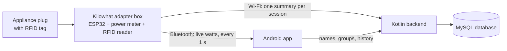
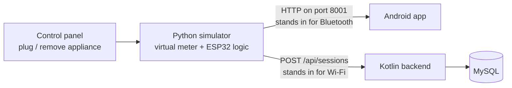

# Kilowhat

**Make any outlet smart. See exactly which appliance is using your electricity.**

Kilowhat is an IoT prototype: a small adapter box that plugs into a regular wall outlet, recognizes each appliance by an RFID tag on its plug, measures how much power it uses, and sends the results to a Kotlin mobile app.

> **Branch: `Kilowhat_python-simulation`**
> In this branch the hardware adapter is replaced by a Python script, so the whole system (app, backend, database) can be built and tested on one PC without any electronics.

---

## 1. How to run

### What you need

| Tool | Used for |
| :--- | :--- |
| XAMPP (MySQL / MariaDB) | The database |
| JDK 17 | The Kotlin backend |
| Android Studio + an emulator (or an Android phone) | The mobile app |
| Python 3.8 or newer | The hardware simulator (its control panel uses `tkinter`; on Linux install `python3-tk`) |

Start things in this order: **database, backend, simulator, app.**

### Step 1: Database

1. Open the XAMPP Control Panel and start **MySQL**.
2. Import [`database/kilowhat_init.sql`](database/kilowhat_init.sql) using phpMyAdmin (**Import** tab), or from a terminal:
   ```bash
   mysql -u root < database/kilowhat_init.sql
   ```

This creates the `kilowhat_db` database with four tables: `outlets`, `groups`, `appliances`, and `sessions`.

> If you imported an older version of this script before, drop `kilowhat_db` first (this deletes saved sessions) and import again. The script uses `CREATE TABLE IF NOT EXISTS`, which does not add new columns to tables that already exist.

### Step 2: Backend (`http://localhost:8080`)

```bash
cd backend
./gradlew bootRun          # Windows PowerShell: .\gradlew.bat bootRun
```

Wait for `Tomcat started on port 8080`, then check it:

```bash
curl http://localhost:8080/api/health
# {"status":"ok","database":"up"}
```

The backend connects to `127.0.0.1:3306` as `root` with an empty password (the XAMPP defaults). To change this, edit `application.yml` in the backend's resources folder.

You can also open the `backend` folder in IntelliJ IDEA and run `KilowhatApplication.kt`.

### Step 3: Python hardware simulator

In a new terminal:

```bash
cd simulator
python kilowhat_adapter_sim.py
```

A small **control panel** window opens (this is where you plug appliances in), and the **logs stay in the terminal**. Optional settings:

| Option | Meaning | Default |
| :--- | :--- | :--- |
| `--port` | Port for the simulated Bluetooth link | `8001` |
| `--backend-url` | Where finished sessions are sent | `http://localhost:8080/api/sessions` |
| `--stray-interval` | Average seconds between stray-current blips on an empty outlet (`0` turns them off) | `40` |

### Step 4: Choose how the app reaches your PC

Inside an Android emulator or phone, `localhost` means *the phone itself*, not your PC. Open [`android/app/build.gradle.kts`](android/app/build.gradle.kts) and set the two URLs for your setup:

| Setup | Backend URL | Simulator URL | Extra step |
| :--- | :--- | :--- | :--- |
| **Android emulator** (default) | `http://10.0.2.2:8080/` | `http://10.0.2.2:8001/` | None |
| **Phone over USB** | `http://localhost:8080/` | `http://localhost:8001/` | Run `adb reverse tcp:8080 tcp:8080` and `adb reverse tcp:8001 tcp:8001` |
| **Phone over Wi-Fi** | `http://<your-PC-IP>:8080/` | `http://<your-PC-IP>:8001/` | Find your IP with `ipconfig`; allow ports 8080 and 8001 in Windows Firewall |

### Step 5: Run the app

1. Open **Android Studio** and choose **Open**, then select the `android` folder.
2. Wait for Gradle sync to finish.
3. Pick your emulator or phone, then press **Run**.

### Step 6: Try it out

1. **Connect.** In the app's **Real-Time** tab, tap **Demo PY Script**. The app pairs with the simulator and starts showing live readings.
2. **Plug in an appliance.** In the simulator's control panel, type an Appliance ID (for example `RFID_TAG_A771B`), enter how many seconds, choose **Active**, and click **Plug in appliance**. Watch the live Watts, Volts, and Amperes in the app.
3. **Finish the session.** Wait for the timer, or click **Remove appliance** to unplug early. After a 5-second cooldown the simulator sends the session summary to the backend.
4. **See the result.** Open the **Devices** tab. The appliance appears under **Unknown / Unassigned** with its raw ID and its consumption in Wh.
5. **Name it.** Tap **+**, choose **Manual Input**, enter `RFID_TAG_A771B` and a name like `Fridge`. The name shows up everywhere, including old sessions.
6. **Group it.** Tap **+**, choose **Create Group**, name it (for example `Maria's Devices`), tick `Fridge`, and save. The Fridge moves into the new group card and the group total updates.
7. **Name the outlet.** Back on the Real-Time tab, tap the pencil icon next to the outlet ID and give it a name like `Living Room Left`.

### Troubleshooting

| Problem | What to check |
| :--- | :--- |
| App says it could not reach the simulator | Is the Python script running? Are you using the right URL for your setup (Step 4)? |
| App returns to "disconnected" right after connecting | Tap **Demo PY Script** again. The simulator rejects live-data requests until the app has paired. |
| Sessions never appear in the Devices tab | Is the backend running? If it is offline, the simulator prints the session JSON in the terminal instead of saving it. |
| Backend fails to start | Is MySQL running in XAMPP, and was the SQL file imported? |

---

## 2. The problem

**Your electricity bill shows one big number. It never tells you who or what is behind it.**

You can't tell whether the aircon, the old fridge, or somebody's gaming PC is responsible, and you can't compare a month with and without an appliance. Replacing every outlet or appliance with a "smart" one is expensive and not realistic for most homes.

**Kilowhat is an attachment, not a replacement.** The adapter plugs into any outlet you already have. Every appliance plug gets a small RFID tag that you label once (for example "Fridge", owned by "Maria"). From then on, Kilowhat shows consumption per appliance and per person, in real time and over time.

*Future recommendation (out of scope for this prototype):* build the same technology directly into the outlets themselves.



---

## 3. The Kotlin App

The app has two parts: an **Android app** (what the user sees) and a **Kotlin backend** (stores and totals the history).

| Part | Technology |
| :--- | :--- |
| Android app | Kotlin, Jetpack Compose with Material 3, coroutines, Retrofit |
| Backend | Kotlin, Spring Boot, JDBC |
| Database | MySQL / MariaDB (XAMPP) |

**The golden rule:** the hardware only knows raw IDs like `RFID_TAG_A771B`. Human-friendly names ("Fridge", "Maria's Devices") live only in the database. Names are looked up when data is *read*, so renaming something once instantly updates every screen, including sessions recorded before the rename.

### Screens

**Real-Time tab** (live view, over Bluetooth)
- Not connected: instructions and three buttons: **Connect thru NFC** and **Manual Bluetooth Connection** (placeholders for now) and **Demo PY Script** (connects to the simulator).
- Connected: live **Watts, Volts, Amperes** and the **active appliance**, updated every second. A pencil icon next to the outlet ID lets you give the outlet a name. A **Disconnect** button stops the stream.

**Devices tab** (history, over Wi-Fi data)
- A **System Metrics** card at the top shows the total consumption of the whole household.
- Below it, one expandable card per **group** (for example "Maria's Devices"), showing the group's total next to an arrow. Tap a card to open it and see its appliances.
- Appliances not assigned to a group are collected in **Unknown / Unassigned**.
- Tap any appliance to see its full list of past sessions (start and end time, duration, outlet, Wh).
- The **+** button offers three actions:
  - **Use NFC** (placeholder, disabled for now)
  - **Manual Input**: type a raw appliance ID and give it a name
  - **Create Group**: name a new group and tick which appliances belong to it

### Database tables

| Table | What it stores |
| :--- | :--- |
| `outlets` | Outlet ID and an optional custom name |
| `groups` | Group name (for example "Maria's Devices") |
| `appliances` | Raw appliance ID, optional custom name, optional group |
| `sessions` | Raw history only: outlet, appliance ID, start, end, Wh consumed |

Sessions are always accepted, even for outlets or appliances nobody has named yet. Group totals are calculated with database joins.

### Backend API

| Endpoint | Purpose |
| :--- | :--- |
| `POST /api/sessions` | Receives a finished session from the adapter |
| `GET /api/groups/summary` | Household total, group totals, and appliances per group |
| `GET /api/appliances/{rfid}/sessions` | Session history of one appliance, newest first |
| `POST /api/appliances/register` | Name an appliance and/or assign it to a group |
| `POST /api/groups` | Create a group and assign appliances to it |
| `POST /api/outlets/register` | Name an outlet |
| `GET /api/appliances/{rfid}`, `GET /api/outlets/{id}` | Look up a custom name |
| `GET /api/health` | Check that the backend and database are up |

---

## 4. The ESP32 / Hardware

The adapter is a box that plugs into an outlet; appliances plug into the box. Inside it:

| Component | Role |
| :--- | :--- |
| **ESP32** | The brain. Polls the meter, runs the logic, talks Bluetooth and Wi-Fi. |
| **PZEM-004T V4.0 100A** | The power meter. It only measures; the ESP32 asks it for readings. |
| **Split-core CT clamp** | Part of the PZEM. It must clamp around the **Live wire only**. Clamping Live and Neutral together cancels out and always reads 0 W. |
| **RFID reader** | Reads the tag on the appliance's plug to identify it. |
| **NFC tag** | Sits on the box and holds the Bluetooth details, so a phone can pair by tapping. |

Each reading from the PZEM includes voltage, current, power (W), cumulative energy (Wh), frequency, and power factor. The meter does not send data on its own; the ESP32 requests it over a serial link.

> The adapter works with mains voltage. Wiring it should be done by someone qualified.

### What the ESP32 does

1. **Identify.** The RFID reader scans the appliance plug and the ESP32 remembers the raw ID. The ESP32 never knows names like "Fridge"; it only sends the ID.
2. **Filter noise.** Any reading under **4 W** counts as 0 W. This hides ghost readings and electrical noise.
3. **Start a session.** When power rises above 4 W, the ESP32 saves the **appliance ID and the meter's current Wh** in its RAM (not flash memory, which wears out from repeated writes).
4. **Stream live data.** Every second it sends watts, volts, and amperes to the paired phone over **Bluetooth Low Energy**. This needs no internet and costs the server nothing.
5. **End a session with a cooldown.** When power drops to 0, it waits **5 seconds**. If the appliance comes back (for example a fridge or iron cycling on and off), the session simply continues.
6. **Calculate.** After the cooldown, it computes `ending Wh - starting Wh`. Tiny, accidental sessions are discarded.
7. **Send one summary.** Over **Wi-Fi**, it sends a single small JSON summary per session to the backend. The raw start and end meter values stay on the ESP32 and are never stored in the cloud.

### Two separate data paths

| Purpose | Link | Data | Goes to |
| :--- | :--- | :--- | :--- |
| Live view | Bluetooth Low Energy | Watts, volts, amperes, active appliance ID (every second) | The phone |
| Permanent history | Wi-Fi (HTTP POST) | One summary per session | The backend database |

### Pairing

The app is meant to pair by **tapping the phone on the NFC tag** on the box. In this prototype NFC and manual Bluetooth pairing are placeholders; see the next section.

---

## 5. The Simulation

Before the hardware is ready, a Python script (`simulator/kilowhat_adapter_sim.py`) plays the role of the adapter box. It follows the same rules as the ESP32 logic above, so the app and backend can be built and tested on one PC.



### What is real and what is simulated

| Real hardware | In the simulation |
| :--- | :--- |
| PZEM-004T power meter and CT clamp | A virtual meter in Python that generates realistic readings |
| RFID reader and tags | An **Appliance ID** text box in the control panel |
| Plugging and unplugging an appliance | **Plug in appliance** and **Remove appliance** buttons, plus a seconds timer |
| Bluetooth Low Energy | A small local HTTP server on **port 8001** (`POST /pair`, `GET /ble-stream`, `POST /unpair`) |
| NFC tap-to-pair | The **Demo PY Script** button in the app |
| Wi-Fi to the backend | A normal HTTP POST to `http://localhost:8080/api/sessions` |

### Demo buttons in the app

- **Demo PY Script** (Real-Time tab): pairs the app with the simulator and starts the live stream.
- **Connect thru NFC** and **Manual Bluetooth Connection**: visible placeholders for the real connection methods.
- **Use NFC** (Devices tab, **+** menu): disabled placeholder.
- **Manual Input** (Devices tab, **+** menu): the stand-in for NFC registration. You type the same Appliance ID you used in the simulator and give it a name.

### The control panel

| Control | What it does |
| :--- | :--- |
| Appliance ID | The simulated RFID tag. **Leave it empty to use `unknown_id`.** |
| Seconds | How long the appliance stays plugged in |
| Active / Standby | Active draws normal power. Standby is plugged in but idle (see below). |
| Plug in appliance | Plugs it into the one simulated outlet |
| Remove appliance | Unplugs it before the timer ends and starts the 5-second cooldown |

The simulator keeps running in the background while the panel is open, so the control panel, the Bluetooth link, and the Wi-Fi push all work at the same time.

### Behaviors we built into the simulation

**Session rules (same as the ESP32 logic)**
- Readings under **4 W** are treated as 0 W.
- A session starts above 4 W. The simulator stores the **appliance ID and the starting Wh together in memory**.
- Energy is added up every second (1 watt = 1 joule per second) into a running meter.
- Removing the appliance starts a **5-second cooldown**, then the session is closed and **one summary is sent**.
- Sessions under 0.01 Wh are discarded.

**Plugging in again during the 5-second cooldown**
- **Same ID:** the session continues as if nothing happened.
- **Different ID:** the previous session is sent to the backend immediately, then a new session starts for the new appliance.

**Unknown appliances**
- No ID entered means the ID is `unknown_id`. This covers a random appliance that someone plugs into the smart outlet. Its consumption adds up under **Unknown / Unassigned** in the Devices tab.

**Realistic idle behavior**
- The meter works from the moment the script starts, so the app can pair before anything is plugged in. It reads about 230 V and 0 W.
- **Ghost readings** (0 to 3 W of noise) are filtered out by the 4 W gate.
- **Stray current** happens only when nothing is plugged in: a brief blip of 2 to 15 W that lasts a second or two. Some blips cross the 4 W gate. They have no RFID tag, so they never start, extend, or get billed as a session.
- **Standby** mode: an appliance is plugged in but draws less than 4 W, so it reads 0 W and no session starts.
- Each Appliance ID always draws a similar wattage (roughly 60 to 600 W) with small natural fluctuations, so results look consistent between runs.

**Reading the terminal**

Every hardware line starts with `[HW ][# BLE]`, where `#` is how many phones are paired (`0` before the app connects, `1` after). Wi-Fi activity uses its own `[WIFI]` tag, so you can see exactly when data is sent.

```
10:15:02 [HW ][1 BLE] tick  3.2s | rfid=RFID_TAG_A771B |   283.5 W | 229.6 V | 1.235 A | odometer 0.3248 Wh
10:15:21 [WIFI] pushing session summary -> http://localhost:8080/api/sessions
```

**If the backend is offline**, the simulator does not crash. It prints the session JSON in the terminal instead, so you can inspect it:

```json
{
  "outlet_id": "OUTLET_NODE_01",
  "appliance_rfid": "RFID_TAG_A771B",
  "start_timestamp": "2026-11-08T10:15:00.000+08:00",
  "end_timestamp": "2026-11-08T10:15:18.000+08:00",
  "total_wh_consumed": 12.34
}
```

The simulated outlet identifies itself as `OUTLET_NODE_01`.

### What changes in the next stages

The session summary and the database stay the same when the Python script is replaced by real ESP32 firmware. What changes is the live link: the app will talk Bluetooth Low Energy instead of this simulation's HTTP link.